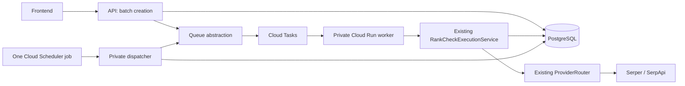

# Asynchronous rank checks (M5)

User requests create a `RankCheckBatch` and one `RankCheckJob` per active Keyword,
then return HTTP 202. PostgreSQL commits all rows before external queue calls.
The first ten jobs enqueue concurrently; the dispatcher drains remaining pending
jobs in bounded chunks. The 5,000-keyword safety ceiling replaces the old HTTP
execution limit. Provider selection is entirely internal.

Locally, `LocalTaskQueue` accepts a deterministic name and the development runner
reads the same committed jobs from PostgreSQL. It runs every two seconds through
`python -m scripts.rank_jobs --loop`. There is no volatile in-memory delivery
requirement, no Redis queue, and no GCP credentials. The queue adapter does not run
SERP searches. Worker HTTP and local runner share `RankCheckWorker.execute(job_id)`.

## Transactions and idempotency

Every job transition locks its Batch, then its Job. Batch counters are aggregates
of Job status, not read/modify/write counters. Batch reconciliation occurs after
flushing each transition while holding the Batch lock. History aggregates all
batches in one query; job lists use bounded queries and cursor pagination.
`queued_keyword_count` means jobs currently queued, not cumulative enqueue count.

Claiming increments `attempt_count`, generates `worker_execution_id`, and commits
a 300-second lease. Live duplicate deliveries receive HTTP 503 without incrementing
attempts, so an unfinished original request cannot cause its task to be silently
acknowledged. Terminal jobs and unknown job IDs return 2xx without provider calls.

The engine atomically links its first RankCheck to the Job in the engine's start
transaction. Retries reuse this RankCheck and its original search snapshot. This
avoids duplicate history even after a crash between RankCheck persistence and Job
completion. The retry still validates the current Project and Keyword state.

Before start, success persistence, or failure persistence, the engine locks the
Job and verifies its execution ID and lease. A late worker whose lease was reclaimed
cannot write SERP results or failure state. Provider I/O holds no database row lock.
A successfully persisted RankCheck is reconciled to a succeeded Job on redelivery,
even if the final Job transaction previously failed.

Provider attempts continue numbering across job retries. The router's per-call
fallback count and budget reservations are unchanged. A late provider attempt can
still finish its accounting, but cannot write rankings after losing the lease.
The existing partial unique constraint prevents concurrent RankChecks for the same
Keyword; overlapping jobs fail with `RANK_CHECK_ALREADY_RUNNING` rather than removing
that constraint. History and operational foreign keys restrict deletion. Delete a
schedule without deleting batches; the historical schedule reference becomes null.

## Retry, recovery and cancellation

Timeouts, temporary unavailability/rate limits, persistence failures, and temporary
infrastructure errors retry with 30–300 second exponential application backoff.
At most five claims occur. Provider authentication/configuration errors, archived
Projects, paused Keywords, unsupported configuration, exhausted static budgets,
and no eligible provider are terminal. Provider retry and router fallback remain
separate from job claims.

Cloud Tasks owns transport retries: terminal application failures return 200;
retryable failures return 503. Transport delivery counts can exceed application
claim counts because active leases/backoff deliveries do not count as attempts.
Queue retry duration is configured to one hour; transport termination also depends
on its attempt threshold. Recovery uses a separate last-update age cutoff. The worker application timeout is lease minus
five seconds; deploy Cloud Run with a 300-second request timeout and lease 300.

`make recover-rank-jobs` drains pending jobs, runs eligible local jobs, and reconciles
incomplete batches. The Cloud Scheduler dispatcher also runs recovery. Cloud task
names use the UUID first, followed by `-rank-check`; repeated enqueue uses the same
name. AlreadyExists is accepted only as queue acceptance; it never proves execution.
After the queue retry horizon plus lease headroom, stranded cloud jobs are marked
`TASK_DELIVERY_EXHAUSTED` (or succeeded if results were already saved). This avoids
pretending a deleted task name's deduplication tombstone is a new deliverable task.
Expired leases may be reclaimed by Cloud Tasks redelivery; local recovery reclaims
them directly. A crash at the maximum attempts terminally fails the job and closes
any running RankCheck.

Cancellation marks pending/queued jobs cancelled. Running jobs may finish. A cancelled
job's future task delivery is acknowledged without execution. Mixed batches containing
cancelled jobs finish as cancelled unless they also have failures, in which case they
finish as completed_with_errors. All-failed batches also use completed_with_errors;
`failed` is reserved for a batch-level failure.

## Schedules

One schedule per user/project, with daily or weekly frequency, `HH:MM`, IANA timezone,
and weekly weekday (Monday 0). `next_run_at` is UTC. Spring DST gaps shift forward by
the gap; fall folds execute the first occurrence only. Dispatch locks due schedules
with SKIP LOCKED. `(schedule_id, scheduled_for)` uniqueness protects each occurrence.
An overdue schedule emits at most one catch-up batch and advances to the future.
A previous unfinished scheduled batch prevents another overlapping batch. Archived
Projects disable schedules; empty Projects advance without producing jobs.

## Observability and cost

JSON events include batch/job/execution identities, attempt count, safe error code,
RankCheck ID and duration. Provider request accounting stays in the existing usage
and attempt tables. Job state queries give queue depth, success/failure/retry rates;
batch timestamps give elapsed duration. No raw payloads or secrets are logged.

Start with dispatch rate 2/s, two concurrent dispatches, Cloud Run concurrency 1,
max worker instances 2, min instances 0, DB pool size 2 and overflow 0. Budget DB
connections as API instances × API pool plus worker instances × worker pool (initial
worker maximum: four connections). Keep infrastructure in nearby compatible regions.
Use one Scheduler job every five minutes; no always-on production VM, Memorystore,
Celery, Redis queue, Kubernetes or Pub/Sub requirement.

No billing, arbitrary cron, notifications, competitors, multi-page SERPs, advanced
analytics or autoscaling optimizer is added. Budgets remain static backend config.
Operational Batch/Job retention needs a future policy; no history is deleted now.
