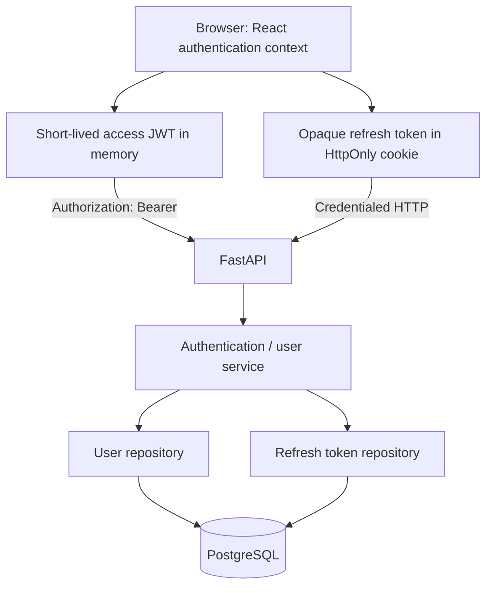

# Authentication and user ownership

## Tenant boundary

**Tenant boundary = authenticated user. Future resource ownership = user_id.**
No additional ownership container, membership, team, or role model is implemented.
`get_current_user` validates the Bearer signature, expiration, token type, and UUID
subject, loads that user, and rejects missing/disabled accounts. Never use a body,
query string, or custom user-ID header as the authorization identity.

No future user-owned resource may be retrieved, changed, or deleted solely by its
resource ID. Require `current_user.id` as an explicit repository argument and put
both owner and resource predicates into the database query. For a future project
repository, the convention is `get_for_user(project_id, user_id=current_user.id)`.
Never fetch unrestricted resources and rely only on a later ownership check.
No project or keyword table is introduced in Milestone 2.

## Persistence and transactions

`users` has UUID4 identifiers, normalized unique emails, Argon2id password hashes,
active/disabled status, nullable verification/login timestamps, and UTC Terms,
created, and updated timestamps. An email normalization check plus the unique
constraint enforces the invariant in PostgreSQL, including registration races.

`refresh_tokens` has a UUID4 primary key, a user FK with ON DELETE CASCADE, unique
SHA-256 token hash, expiration/revocation/last-used timestamps, and indexes on
user ID and expiration. Its unique constraint supplies the hash lookup index.
Raw tokens are never persisted. No authentication operation uses Redis.

The existing request-scoped SQLAlchemy transaction commits before the response
is sent and rolls back on failure. User creation and session creation are atomic.
Repository insertion uses PostgreSQL ON CONFLICT against the email constraint to
handle racing registrations without returning database exceptions.

Refresh and logout lock the matching token row with SELECT FOR UPDATE. A second
concurrent refresh observes the revoked token after the first transaction commits
and fails. A failed replacement insertion rolls back revocation, preserving the
previous session. Revocation is stored in PostgreSQL.

## Flows

Registration: validate request and reject unknown fields → normalize email →
require Terms and password policy → hash password off the event loop → insert
user with server UTC Terms timestamp → insert refresh hash → commit → return
access JWT and safe user fields with HttpOnly cookie. Confirmation is frontend
validation only and is never part of the registration API request.

Login: normalize email → lookup user → verify password → require active user →
update last_login_at → create session → commit → return JWT/user and refresh
cookie. Unknown email and incorrect password return the same status/code/message;
unknown accounts still perform Argon2 verification against an application-owned
dummy hash. No password or credential is logged.

Refresh: read HttpOnly cookie → hash it → lock row → check expiration/revocation →
load active user → revoke old row and set last_used_at → create replacement →
commit → issue JWT and replace cookie. Old tokens remain invalid.

Protected request: Bearer JWT → `get_current_user` → verify claims → load active
user → service/router. `/users/me` returns only explicitly selected public fields.

Logout: read cookie → lock/revoke matching row if present → commit → expire cookie
with identical attributes → clear frontend access token, user, and user query cache.
Missing/unknown/already-revoked cookies are safe. Access JWTs remain valid until
expiry unless the account is disabled; immediate access revocation is deferred.

## Browser and transport

An AuthSession instance belongs to its React provider, avoiding shared mutable
server state. On startup it makes one refresh attempt. A successful reload restores
the in-memory token/user; a missing session becomes anonymous. Backend outages
produce a retryable state rather than redirect loops. `/app` renders no user data
until authenticated and confirmed through `/users/me`.

Authenticated HTTP calls share a single-flight refresh per mounted application
and retry the original request once. Logout waits for an in-flight rotation before
revoking the resulting cookie. A generation check prevents stale requests from
restoring a session after logout. User identity changes clear TanStack Query data.
There is no token persistence in localStorage, sessionStorage, or URLs.

The HttpOnly cookie uses `/api/v1/auth`, configurable SameSite (Lax by default),
and Secure in production. All authentication POSTs require JSON and reject
untrusted Origin values. This combines explicit credentialed CORS, non-simple
requests, and origin validation. Sensitive responses and errors use `no-store`.
Production rejects DEBUG=true, insecure cookie settings, and placeholder/weak JWT
configuration. Secrets come only from backend settings.

JSON logs contain event descriptions and HTTP method/path/status/duration, never
payloads, query strings, Authorization/Cookie headers, hashes, or tokens. Future
rate limiting belongs at the auth endpoint boundary for register/login/refresh.

The implementation uses the documented [Argon2id password API](https://argon2-cffi.readthedocs.io/en/stable/api.html),
[PyJWT claim validation](https://pyjwt.readthedocs.io/en/stable/api.html), and
[OWASP guidance on CSRF protection for JSON APIs](https://cheatsheetseries.owasp.org/cheatsheets/Cross-Site_Request_Forgery_Prevention_Cheat_Sheet.html).
