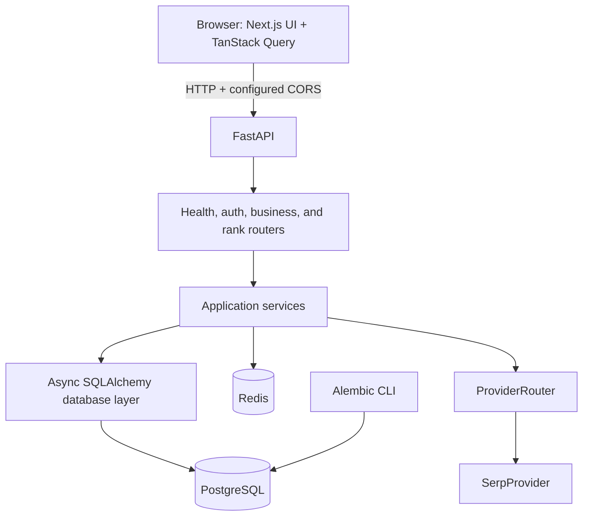

# Architecture foundation

Next.js serves `/` and `/health`. The browser queries three HTTP health endpoints
through `src/lib/api/client.ts`. Each dependency displays independently, including
loading and failure states. TanStack Query refreshes every 30 seconds. The frontend
never accesses PostgreSQL or Redis directly.

FastAPI uses an application factory and lifespan-owned engine, session factory,
and Redis client. Database transactions commit after successful dependencies,
roll back on exceptions, and always close. Dependency health checks are bounded
by timeouts. `/health` is liveness, while `/health/db` and `/health/redis` explicitly
check dependency readiness and return 503 on failure.

Settings are typed and validated centrally. Environment variables override `.env`.
Production debug mode is rejected; HTTP errors never include tracebacks. Request
logs are JSON with timestamp, level, logger, message, method, path, status code,
and duration in seconds. Query strings, payloads, headers, connection strings,
and raw exception details are excluded from application logging.

Only Alembic manages schema changes. The initial empty revision deliberately
creates no business tables. Compose runs `alembic upgrade head` in its container
command after PostgreSQL and Redis health checks pass; the FastAPI lifespan does
not create tables or run migrations. Production deployments should run migrations
as a single release step before starting API replicas.

Business endpoints belong in `app/api/v1` and are mounted under `/api/v1`.
Models belong in `app/models` and are registered in `app/db/models.py`.
Keep SQL in the database/repository layer and domain operations in services.
The authenticated user is the tenant boundary. User → Project → Keyword and
User → Tracked Site → Tracked Domain ownership are explicit and enforced using
authenticated `user_id` in repository queries. See [authentication](authentication.md),
[project/keyword ownership](project-keyword-model.md), and
[tracked sites](tracked-sites.md).
Manual Rank Checks use a provider-independent interface. External HTTP runs between
short database transactions; successful normalized results, Site matches, and the
final status commit atomically. See [provider architecture](serp-provider.md),
[provider routing](provider-routing.md), [ranking engine](ranking-engine.md), and
[domain matching](domain-matching.md).

Compose startup ordering follows [Docker's health dependency guidance](https://docs.docker.com/compose/how-tos/startup-order/).
Async migrations use the [Alembic asyncio recipe](https://alembic.sqlalchemy.org/en/latest/cookbook.html#using-asyncio-with-alembic).
