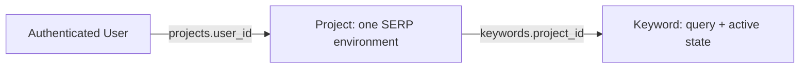

# Project and Keyword model

The authenticated User is the only tenant. Every Project lookup includes
`current_user.id`; every Keyword resource lookup joins through the exact
user-owned Project. Request bodies cannot assign ownership. Foreign and missing
IDs produce the same 404 response.

A Project owns `search_engine`, `country_code`, `language_code`, `device`, and
optional `location`. There are no `default_*` fields and no domain. Updating these
values defines the environment used by every Project Keyword for future checks.
A Keyword stores display text, normalized comparison text, active state, and
timestamps only. PostgreSQL uniqueness is `(project_id, keyword_normalized)`.

Project creation requires one to 1000 submitted keyword lines. The service cleans
empty lines, normalizes Unicode and whitespace, removes normalized duplicates,
then inserts the Project and all remaining Keywords in the request transaction.
Any unexpected persistence failure rolls back the Project too. Separate single
and bulk Keyword endpoints remain available.

Projects have no direct relationship to Tracked Sites. A manual Rank Check snapshots
the Project environment and Keyword query, then matches returned organic hostnames
against all active Sites and aliases owned by the same user. Workers and schedules
are not implemented.
