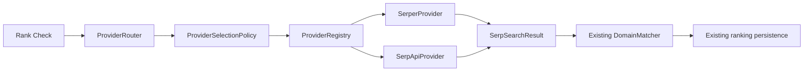

# Provider routing

Provider selection is backend infrastructure. End users configure the Project's
search engine, country, language, device, location, and Keywords; request schemas
reject provider and budget fields.

`fixed` selects only `SERP_FIXED_PROVIDER` and exposes missing credentials or
unsupported settings as a stable failure. `priority` evaluates
`SERP_PROVIDER_PRIORITY` in order and chooses the first provider that is enabled,
configured, semantically capable, and within its optional request budget. A blank
budget means unlimited internal usage; configured values are application safety
ceilings, not provider balances or billing limits.

The router may move to one fallback provider only after timeout, temporary
unavailability, rate limiting, or identifiable quota exhaustion. It does not
fallback after authentication, invalid request, unsupported configuration,
parsing/schema, or internal failures. Adapter retries and provider fallback are
separate; `SERP_MAX_PROVIDER_FALLBACKS` bounds the latter.

Before every upstream request, an atomic PostgreSQL reservation increments the
current monthly `provider_usage` row. Row locking and a unique provider/period key
prevent concurrent budget overspend. Each provider selected and actually called
creates a `rank_check_provider_attempts` row with sanitized status, error code,
timing, and actual request count. `rank_checks.provider` records the successful data
source, while `rank_checks.provider_request_count` totals all requests across
adapter retries and fallback.

Existing Milestone 4 checks remain unchanged and return an empty attempt list.
Attempt rows cascade only with their Rank Check; existing Rank Check history
protections continue to prevent business deletion of historical checks.
