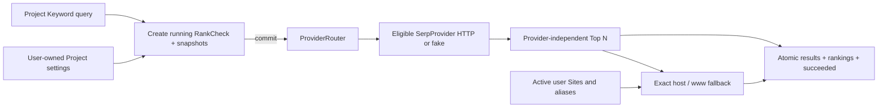

# Ranking engine and history

The service uses two short transactions. Transaction A validates authenticated
ownership and active state, copies the query and complete Project SERP environment,
creates a pending Rank Check, advances it to running, and commits. The provider call
then runs without an open database transaction. Transaction B stores normalized
organic results and matched rankings and marks the check succeeded atomically. A
provider/router error instead marks it failed with a safe code/message. If success
persistence fails, its transaction rolls back all child rows and a separate safe
transaction marks the check failed.

`rank_checks` stores user/project/keyword identity, final provider, status, query,
search-engine, country, language, device, location and result-depth snapshots,
request count/ID, bounded metadata, timestamps, and sanitized errors. A partial
unique index permits only one pending/running check per Keyword.

`rank_check_provider_attempts` stores each provider that received an upstream
request, including its ordinal, safe outcome, request count, and timestamps.
`provider_usage` stores system-wide monthly operational counters and contains no
user or billing ownership.

`rank_check_results` stores the normalized Top N at one row per organic position.
`rankings` stores one best row per Rank Check and Tracked Site, including the Site
name, exact matched alias, result URL, hostname, title, and position. Positive and
uniqueness constraints enforce these invariants.

Rank Checks use composite `RESTRICT` foreign keys to the exact user-owned Project
and project-owned Keyword. Results and Rankings use `RESTRICT` to their Rank Check.
Project/Keyword deletion is refused with `HISTORY_EXISTS` once checks exist. Site
and alias deletion is refused when referenced by rankings; database Site/domain
references are additionally `SET NULL`, so snapshot text remains meaningful even
under direct administrative deletion. Current settings, Keyword text, Site names,
alias state, and primary-domain changes cannot rewrite historical snapshots.

Milestone 4 executes checks synchronously and caps Project requests. The status and
persistence model can support queued workers later without changing history rows;
workers, scheduling, queues, retention automation, billing, and provider result
merging remain outside this milestone.
