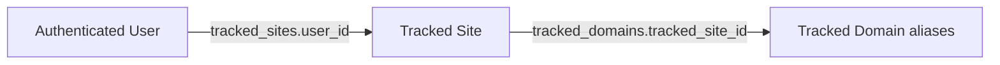

# Tracked Sites and domain aliases

A Tracked Site is a logical SEO asset owned globally by one User. A Tracked Domain
is an exact canonical hostname alias. The same normalized hostname may belong to
different users, while `(user_id, domain)` prevents one user from assigning it to
multiple Sites. A composite foreign key guarantees the Domain and Site user IDs
match.

Every active Site has exactly one active primary domain. A partial unique index
prevents multiple primary rows, and a check constraint prevents an inactive
primary. Promotion locks the Site row, clears the current primary, activates the
target, and promotes it in one transaction. Deleting or disabling a primary is
rejected until another alias is explicitly promoted. Archived Sites retain their
aliases and may remove their last domain, but reactivation then requires a primary.

Domain input accepts bare hosts and HTTP(S) URLs, removes scheme, path, query,
fragment, port, and trailing dot, lowercases, and applies IDNA. Credentials,
unsupported schemes, single-label names, and malformed labels are rejected.
Subdomains and `www` remain exact aliases. The application never contacts these
hosts or resolves redirects.

There is no Project-to-Site mapping in Milestone 3.1.
